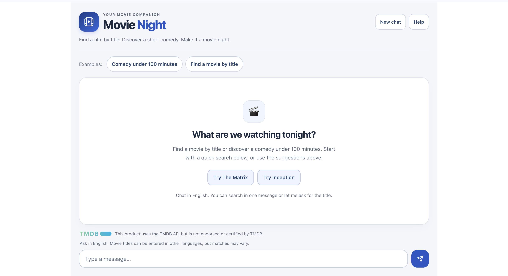
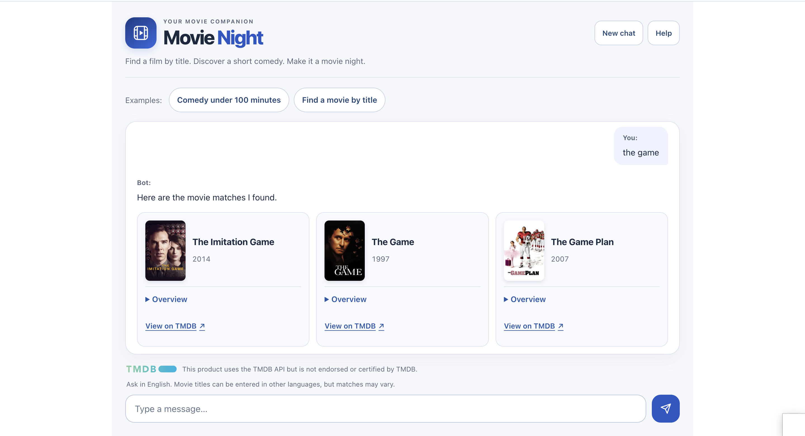

# Movie Night — Backend

A Java 21 and Spring Boot API for a conversational movie discovery application. Google Dialogflow ES recognizes intent and manages conversational parameters; the backend retrieves movie data from TMDB and returns structured results to the React interface.

[Live demo](https://eaichat.vercel.app/) · [Frontend repository](https://github.com/elad9219/chatbot-frontend) · [API documentation](https://aichat.runmydocker-app.com/swagger-ui.html) · [Portfolio](https://eladt-portfolio.vercel.app/)

## Features

- Search for a movie in one message or let the bot ask for its title.
- Discover comedies under 100 minutes and refine the conversation to under 90 minutes.
- Return up to three movie cards with titles, posters, release dates and overviews.
- Provide helpful fallback messages for unsupported requests and unavailable services.
- Bound external requests with connection, read and Dialogflow timeouts.
- Validate message length, request size and session identifiers before calling external services.
- Expose a read-only health endpoint for frontend warm-up and scheduled wake checks.

This is an intent-based chatbot, not a generative AI assistant. Conversation commands are in English. Movie titles can be entered in other languages, but matches depend on Dialogflow extraction and TMDB data.

## Screenshots

### Welcome screen



### Movie search



## Architecture

```text
React frontend → Spring Boot API → Dialogflow ES
                                → TMDB API
```

The frontend sends a message and session ID to the backend. The backend calls Dialogflow through its Java client, routes the recognized intent and retrieves movie results when needed.

An inbound Dialogflow fulfillment webhook is not required.

## Technology

- Java 21
- Spring Boot 4.1.2 and Spring MVC
- Google Cloud Dialogflow ES client
- Spring RestTemplate for TMDB requests
- Spring Boot Actuator
- OpenAPI documentation through springdoc
- Maven, JUnit, Mockito and Spring test support
- Docker and GitHub Actions

No application database is required.

## Local setup

### Requirements

- JDK 21
- Maven
- A TMDB API read access token
- A Google service-account key with permission to call the configured Dialogflow agent

Clone the repository:

```bash
git clone https://github.com/elad9219/chatbot.git
cd chatbot
```

Configure these environment variables in your terminal or IntelliJ run configuration:

| Variable | Purpose |
| --- | --- |
| `TMDB_READ_ACCESS_TOKEN` | TMDB API read access token |
| `GOOGLE_APPLICATION_CREDENTIALS` | Absolute path to the local Google service-account JSON file |

Keep credentials outside tracked source files. Do not commit service-account keys, tokens or deployment configuration containing secrets.

Start the API:

```bash
mvn spring-boot:run
```

The default local address is `http://localhost:8080`.

### Dialogflow configuration

The current implementation targets Google Cloud project `elad-chatbot-dsci`. To use your own project, update `PROJECT_ID` in `DialogflowService` and configure an agent with the corresponding intents.

| Intent | Behavior |
| --- | --- |
| `FindMovieByTitle` | Extracts the required `movieTitle` parameter using `@sys.any`; asks for a title when missing |
| `DiscoverShortComedies` | Discovers comedies under 100 minutes |
| `RefineShortComedies` | Refines a comedy search to under 90 minutes |

Example training phrases include:

- `Find the movie The Matrix`
- `Look up Inception`
- `Find a movie by title`
- `Comedy under 100 minutes`
- `Under 90 minutes`

The backend supplies a `movie-demo` context with each request. Configure the refinement intent as a contextual follow-up to comedy discovery, and provide a fallback response explaining the supported movie requests.

Agent training phrases and contexts are configured in Dialogflow; they are not provisioned by this repository.

## API

| Method | Path | Purpose |
| --- | --- | --- |
| `POST` | `/bot` | Process one conversational message |
| `GET` | `/actuator/health` | Check application health |
| `GET` | `/v3/api-docs` | Read the OpenAPI document |
| `GET` | `/swagger-ui.html` | Open the interactive API documentation |

Example request:

```bash
curl --request POST http://localhost:8080/bot \
  --header 'Content-Type: application/json' \
  --data '{"session":"local-movie-demo","queryResult":{"queryText":"Find the movie The Matrix"}}'
```

Replies contain `fulfillmentText` and `source`. Successful movie searches also include `movies`; relevant replies can include `suggestedReply`.

Movie entries contain `id`, `title`, `overview`, `releaseDate` and `posterPath`.

### Request safeguards

- Maximum message length: 256 Unicode code points.
- Maximum request body: 4,096 bytes.
- Optional session identifiers: 1–36 letters, digits, underscores or hyphens.
- Shared in-memory limit: 60 accepted chat requests per minute per application instance.
- CORS access is configured for the local frontend and the public demo.

The rate limit resets when the application restarts. It is a demo safeguard, not a distributed quota or a guarantee against all abuse.

## Movie discovery rules

Comedy discovery requests released films with:

- Runtime from 40 minutes through 99 minutes, or through 89 minutes after refinement.
- At least 100 votes and an average rating of at least 6.
- Adult content and video entries excluded.
- Results ordered by popularity and limited to three cards.

Search results and availability depend on TMDB and can change over time.

## Tests and build

```bash
mvn clean verify
```

The verified release reported 42 tests: 41 passed and one optional live TMDB test was skipped.

The default suite uses mocked external services. To run the live TMDB check with a valid token already configured:

```bash
TMDB_LIVE_TEST=true mvn verify
```

GitHub Actions runs the Java 21 build and default test suite. Live provider access is verified separately from isolated tests.

## Deployment

The backend runs on RunMyDocker:

```text
https://aichat.runmydocker-app.com
```

The Dockerfile uses a Java 21 runtime and a non-root user. Its build context is restricted to the Dockerfile and packaged application JAR.

Build the JAR before building the image:

```bash
mvn clean verify
docker buildx build --platform linux/amd64 --load --tag chatbot-backend:local .
```

The container exposes port `8080`.

Production configuration is supplied through `SPRING_APPLICATION_JSON`, including:

| Property | Purpose |
| --- | --- |
| `server.port` | Application port |
| `tmdb.read.access.token` | TMDB token |
| `dialogflow.credentials.json` | Google service-account JSON serialized as a string |
| `management.endpoint.health.show-details` | Set to `never` |
| `management.endpoint.health.show-components` | Set to `never` |

The inline Google credential setting is used for container deployment; local development can use the credential file path instead. Credentials are injected at runtime rather than copied into the image.

The hosting platform can put the demo backend to sleep. The frontend performs read-only health checks before sending a message. A separate portfolio workflow also checks the health endpoint.

## Demo limitations

- Requires the configured Dialogflow agent and valid provider credentials.
- Supports specific movie intents rather than arbitrary conversation.
- Depends on external provider availability and quotas.
- Does not persist application chat history in a database.
- Health status confirms application availability, not the availability of every external provider.

## Attribution

This product uses the TMDB API but is not endorsed or certified by TMDB. Movie data and images are supplied by TMDB.

## Author

Elad Tennenboim

- [GitHub](https://github.com/elad9219)
- [Portfolio](https://eladt-portfolio.vercel.app/)
- [LinkedIn](https://www.linkedin.com/in/elad-tennenboim/)
- [Email](mailto:elad9219@gmail.com)